# ROG Astral RTX 5080 - aquasuite

An unofficial aquasuite monitoring dashboard for the **ASUS ROG Astral GeForce RTX 5080 OC**. Displays GPU temperatures and power readings, with optional notifications for issues with the 12VHPWR connector. Not affiliated with or endorsed by ASUS or Aqua Computer.

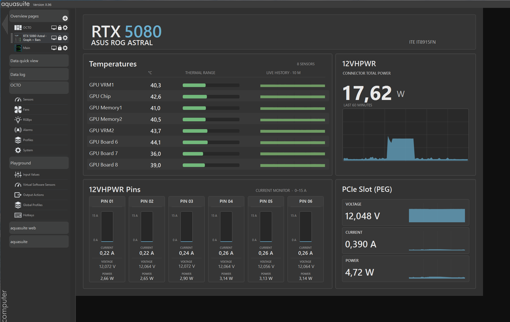

## What the dashboard shows

- Eight temperature readings across the GPU, memory, VRMs, and board, with 10 minutes of history.
- Current, voltage, and power for each of the six 12VHPWR power pins.
- Total connector power and PCIe slot power readings, with one hour of history.

## Requirements

- HWiNFO with **Shared Memory Support** enabled and the sensors window open.
- The GPU's **ITE IT8915FN** sensors available in aquasuite through **Aqua Computer Service → HWiNFO**.

The files are configured for the RTX 5080 Astral OC. For another card, you will need to select the matching data sources.

## Setup

Download the repository. Import the files directly into aquasuite; no build is required.

### 1. Enable data sharing in HWiNFO

Start HWiNFO, enable **Shared Memory Support**, and open the sensors window. Make sure aquasuite can see the temperature sensors and `GPU 12VHPWR Pin1 Current` through `Pin6 Current`.

### 2. Import the dashboard

Under **Overview pages**, create a new page and enable edit mode. Right-click an empty area → **Import page** → select [`ROG_Astral_5080_Power_Thermals.page`](ROG_Astral_5080_Power_Thermals.page).

These two steps are enough to use the dashboard. Continue with the following steps if you also want notifications about 12VHPWR issues.

### 3. Add virtual sensors

In **Playground → Virtual Software Sensors**, import the files from [`sensors/`](sensors/) in this order:

1. `12VHPWRTOTAL.xml`, `12VHPWRMIN.xml`, `12VHPWRMAX.xml`.
2. `12VHPWRAVG.xml`, `12VHPWRDELTA.xml`, `12VHPWRDATAOK.xml`.

To find the import option, right-click a sensor's header. If the list is empty, first create a sensor using `+`.

### 4. Add notifications

In **Playground → Output Actions**, use the same context menu to import all four files from [`outputs/`](outputs/).

**Check the data sources after importing.** If a sensor is unavailable, select it again in the item's settings. You may need to do this for dashboard elements, virtual sensors, and notifications when moving to another PC.

## Virtual sensors

All current readings are in amperes.

| Sensor | Meaning |
| --- | --- |
| `12VHPWR MAX` | Highest current among the pins |
| `12VHPWR MIN` | Lowest current among the pins |
| `12VHPWR TOTAL` | Sum of the currents across all six pins |
| `12VHPWR DELTA` | Difference between the highest and lowest currents: `MAX − MIN` |
| `12VHPWR AVG` | Average current: `TOTAL / 6` |
| `12VHPWR DATA OK` | `1` if `MAX < 50 A`; otherwise `0` |

`DATA OK` detects missing data using a fallback value of 100 A for an unavailable source. There is no separate check for frozen readings.

View the virtual sensor diagrams

**MAX - highest current among the pins.**

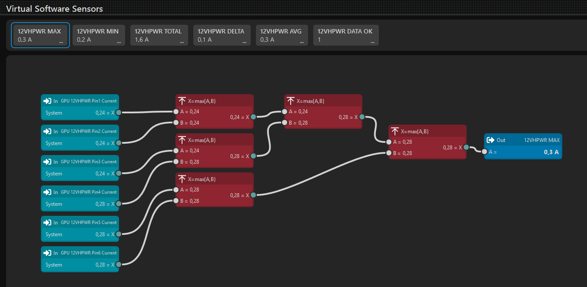

**MIN - lowest current among the pins.**

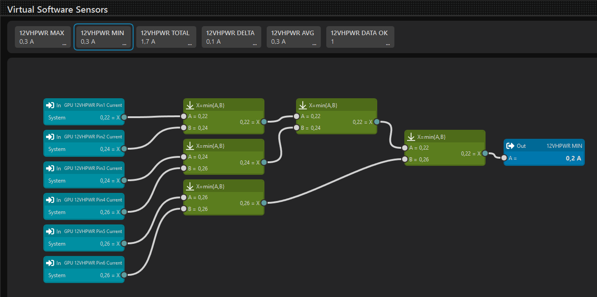

**TOTAL - sum of the currents across all six pins.**

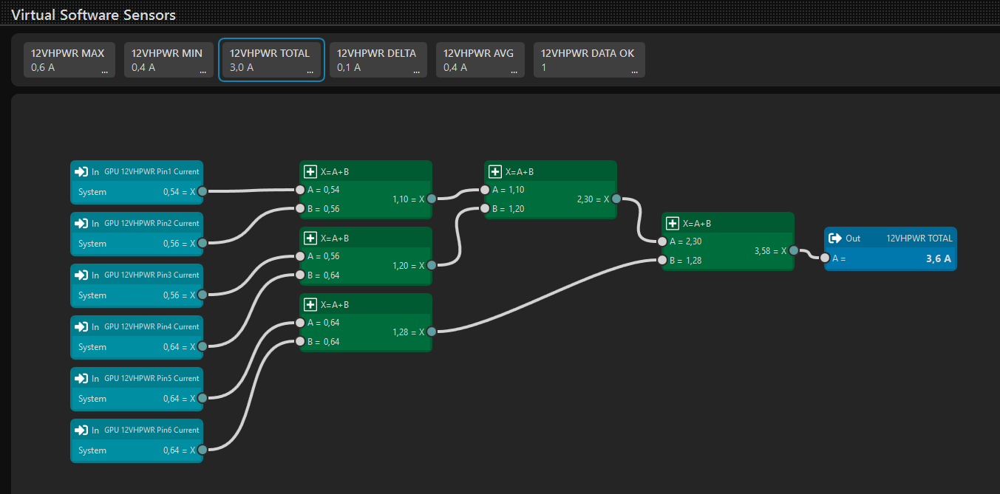

**DELTA - difference between the maximum and minimum currents.**

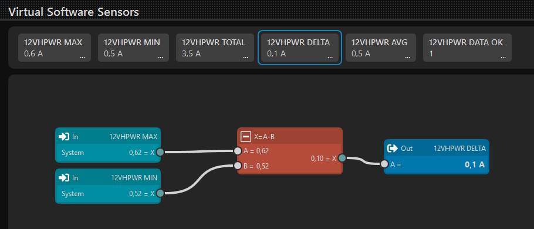

**AVG - total current divided by six.**

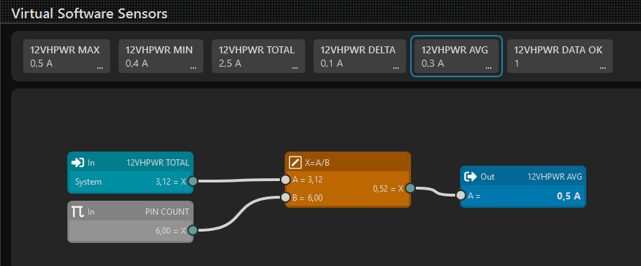

**DATA OK - checks data availability against a current threshold.**

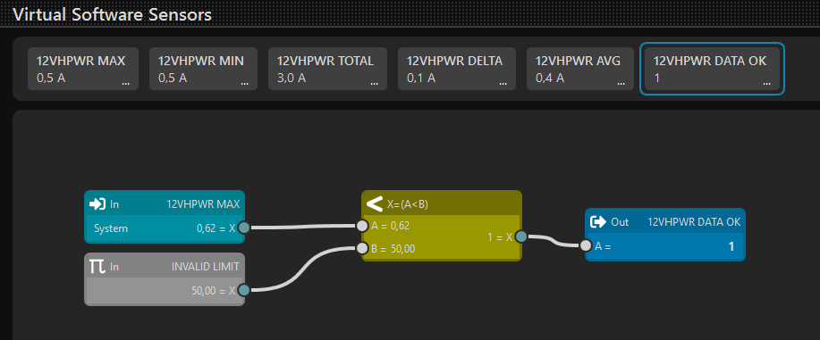

## Output Actions

The four files in [`outputs/`](outputs/) define notification rules for **Playground → Output Actions**. They use the virtual sensors above to detect missing data, excessive pin current, and a pin carrying almost no current under load.

| Output Action | Condition | Delay |
| --- | --- | --- |
| [12VHPWR DATA LOST](outputs/12VHPWR_DATA_LOST.xml) | `DATA OK = 0` | 5 s |
| [12VHPWR HIGH CURRENT](outputs/12VHPWR_HIGH_CURRENT.xml) | Any pin current exceeds **8 A** | 5 s |
| [12VHPWR CRITICAL CURRENT](outputs/12VHPWR_CRITICAL_CURRENT.xml) | Any pin current exceeds **9.2 A** | 3 s |
| [12VHPWR PIN ZERO UNDER LOAD](outputs/12VHPWR_PIN_ZERO_UNDER_LOAD.xml) | Minimum current is below **0.1 A** while total current exceeds **12.5 A** | 5 s |

The high current, critical current, and near-zero pin current rules require `DATA OK = 1`. Data loss notifications also depend on source timeouts, so they do not appear immediately.

View the Output Actions diagrams

### DATA LOST

Calculates `1 - DATA OK`: valid data produces `0`, unavailable data produces `1`. After a 5-second delay, the notification asks you to check HWiNFO and aquasuite.

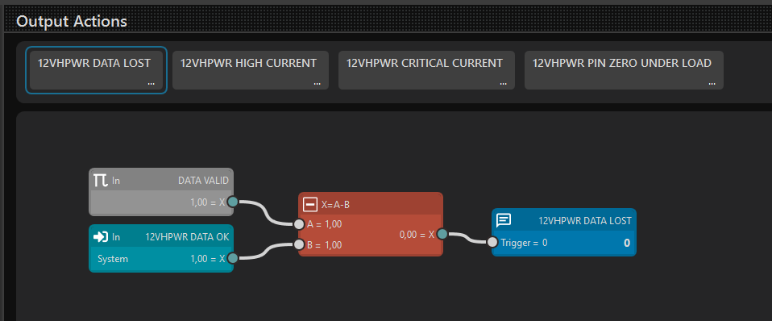

### HIGH CURRENT

Calculates `(MAX - 8) * DATA OK`. With valid data, the notification triggers when any pin exceeds **8 A**, after a 5-second delay. It asks you to check the power connector and cable.

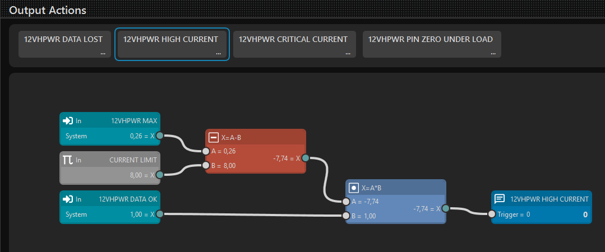

### CRITICAL CURRENT

Calculates `(MAX - 9.2) * DATA OK`. With valid data, the notification triggers when any pin exceeds **9.2 A**, after a 3-second delay. Its message asks you to shut down the PC and inspect the power cable and connector.

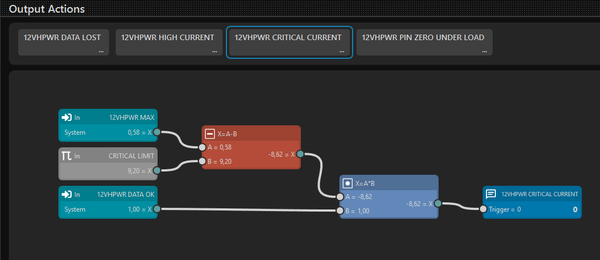

### PIN ZERO UNDER LOAD

Combines `MIN < 0.1`, `TOTAL > 12.5`, and `DATA OK = 1`. All three conditions must be true. After a 5-second delay, the notification reports a pin carrying almost no current under load and asks you to check the GPU power connector and cable.

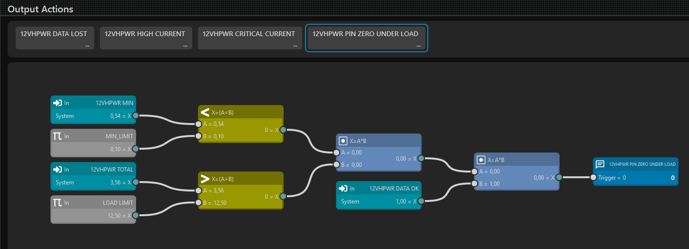

You can change the thresholds in the corresponding Playground rules. These are project settings, not manufacturer-specified limits. Sound and automatic PC shutdown are disabled in these rules.
